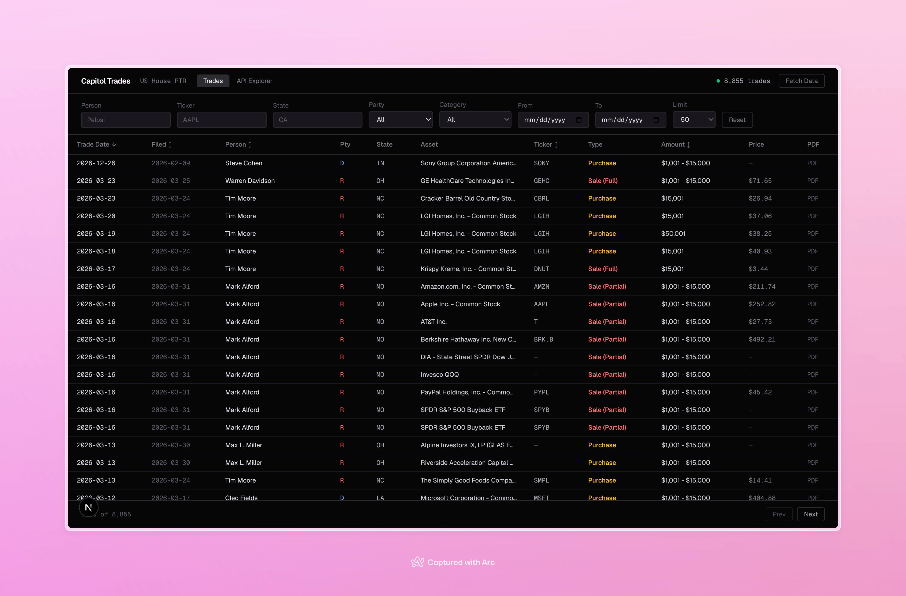
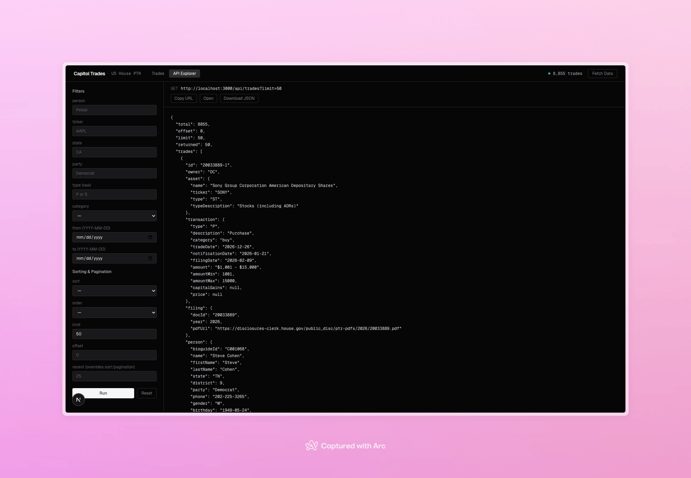

# Capitol API Frontend

Very simple [frontend](https://capitol.crnicholson.com) component for [Capitol API](https://github.com/crnicholson/capitol-api) to view data. 



## Explore the data

The Insights tab summarizes all records matching the filters, independently of
the trade table's page size:

- Activity: monthly purchases, sales, other transactions, and transaction mix.
- Map: transaction counts, transactions per reporting member, and buy/sell balance.
  State details show active members, tickers, and median days from trade to filing.
- Stocks: the most traded tickers and reported activity by party.
- Members: reporting members ranked by their household's transaction count.

Select a month, ticker, member, or state to inspect its trades and source filings.
The views work with both the live API and the static snapshot. Missing, invalid,
and future trade dates are excluded from the timeline and counted in its note.
Charts report transaction counts, not profits or investment returns.

Run the aggregation checks with `node --test tests/analytics.test.mjs`.

## API Builder

If you want to play around with the API and learn how to use it, you can use this to build API queries. 



## Usage

### Use the Website

[capitol.crnicholson.com](https://capitol.crnicholson.com).

### Run Locally

Run:

```
git clone https://github.com/crnicholson/capitol-api.git
cd capitol-api
npm install
npm start
```

Next, in a new terminal:

```
git clone https://github.com/crnicholson/capitol-api-frontend.git
cd capitol-api-frontend
npm install
npm run dev
```

Then, you should be able to access the website at `http://localhost:3001` with the server running on `http://localhost:3000`.
